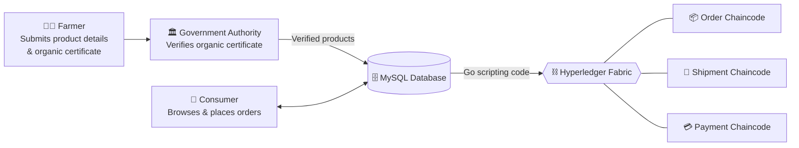
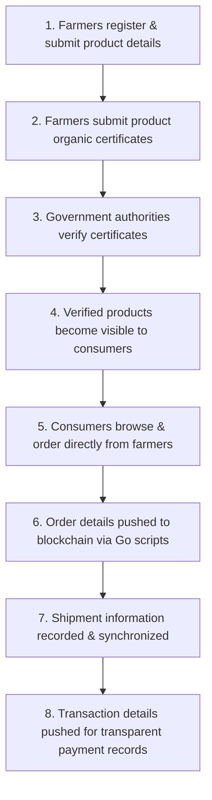

<div align="center">

# 🌾 FarmTrack

### Blockchain-Based Agricultural Supply Chain

**Building Transparency, Trust & Fairness in Agriculture**

A blockchain-powered platform that connects farmers directly with consumers, ensuring transparent transactions, verified organic certification, and fair pricing.

<br>


[About](#-about-the-project) •
[Why Blockchain](#-why-blockchain) •
[Features](#-key-features) •
[Tech Stack](#-technology-stack) •
[Architecture](#-architecture) •
[Getting Started](#-getting-started) •
[Workflow](#-project-workflow) •
[Team](#-development-team)

</div>

---

## 📌 About the Project

**FarmTrack** is a blockchain-based agricultural supply chain management platform that establishes a direct connection between farmers and consumers.

The platform uses **Hyperledger Fabric** to maintain transparent, tamper-resistant agricultural records. Government authorities verify the organic certificates submitted by farmers, so consumers can make informed purchasing decisions with confidence.

By eliminating intermediaries, FarmTrack promotes **fair pricing**, improves **farmers' profitability**, and builds **trust** between producers and buyers.

---

## 🔐 Why Blockchain?

FarmTrack uses blockchain because **data stored on it is immutable**. Once an order, shipment or payment record is written to the ledger, it cannot be altered or deleted.

| Benefit | What it means for FarmTrack |
| :-- | :-- |
| 🔒 **Immutable Records** | Order, shipment and transaction data cannot be changed after it is recorded, so history can always be trusted. |
| 🤝 **Trust Without Intermediaries** | Farmers and consumers can rely on the same tamper-proof record instead of depending on a middleman. |
| 🔍 **Transparency & Traceability** | Every step of the supply chain stays on record and can be audited. |
| 🛡️ **Protection Against Fraud** | Payment and order disputes can be settled using records that nobody can rewrite. |

---

## 🎯 Key Features

| Feature | Description |
| :-- | :-- |
| 🌱 **Farmer Registration** | Farmers can register and manage their agricultural products. |
| 🔗 **Blockchain Integration** | Important agricultural records and transactions are stored securely on Hyperledger Fabric. |
| 💰 **Direct Farmer-to-Consumer Sales** | No intermediaries — consumers transact directly with farmers. |
| 🏛️ **Organic Certificate Verification** | Government authorities verify the organic certificates submitted by farmers. |
| 🚚 **Shipment Monitoring** | Shipment details management with IoT-based environmental monitoring. |
| 💳 **Transparent Transactions** | Every transaction record is maintained on the blockchain. |
| ⭐ **Consumer Feedback** | Consumers can leave product reviews and feedback. |

---

## 🛠️ Technology Stack

| Technology | Purpose |
| :-- | :-- |
| **Hyperledger Fabric** | Blockchain network |
| **Golang** | Blockchain chaincode and database-to-blockchain scripting |
| **PHP** | Server-side web application |
| **MySQL** | Database management |
| **MQTT** | IoT communication |
| **HTML, CSS, JavaScript** | Frontend development |
| **Docker** | Containerization |
| **cURL** | HTTP communication and API requests |
| **jq** | JSON processing |

---

## 🏗️ Architecture

### Stakeholders

FarmTrack is built around three major stakeholders:

| Stakeholder | Role |
| :-- | :-- |
| 👨‍🌾 **Farmer** | Registers agricultural products, submits organic certificates, manages product information, and handles consumer orders. |
| 🛒 **Consumer** | Browses products, purchases directly from farmers, tracks shipments, and provides feedback. |
| 🏛️ **Government Authority** | Verifies the organic certificates submitted by farmers. |

### System Overview



### Blockchain Layer

The blockchain backend consists of three chaincodes written in Go:

| Chaincode | Responsibility |
| :-- | :-- |
| 📦 **Order Chaincode** | Manages order-related information. |
| 🚚 **Shipment Chaincode** | Maintains shipment-related information. |
| 💳 **Payment Chaincode** | Maintains transaction and payment-related information. |

### Database-to-Blockchain Scripting

Three **Go** scripts transfer information from the MySQL database to the Hyperledger Fabric blockchain:

| Script | Functionality |
| :-- | :-- |
| **Order Details Script** | Pushes order details from the database to the blockchain. |
| **Shipment Details Script** | Pushes shipment details from the database to the blockchain. |
| **Transaction Details Script** | Pushes transaction details from the database to the blockchain. |

---

## 📂 Repository Structure

```text
Farmtrack/
│
├── Backend/
│   ├── Chaincode/
│   │   ├── Order/
│   │   ├── Shipment/
│   │   └── Payment/
│   │
│   └── Scripting Code/
│       ├── Order Details/
│       ├── Shipment Details/
│       └── Transaction Details/
│
├── Frontend/
│
├── README.md

```

---

## ⚙️ Getting Started

### Prerequisites

**Required**

- [Git](https://git-scm.com/)
- [cURL](https://curl.se/)
- [Docker](https://www.docker.com/)
- [Go (Golang)](https://go.dev/) — chaincode and database-to-blockchain scripting
- [jq](https://jqlang.github.io/jq/)
- [Hyperledger Fabric binaries](https://hyperledger-fabric.readthedocs.io/)

**Additional**

- [PHP](https://www.php.net/) — if running the web application
- [MySQL](https://www.mysql.com/) — database management

> [!IMPORTANT]
> Make sure the versions of all dependencies are compatible with each other and with your chosen Hyperledger Fabric release. Refer to the official documentation before installation.

### Installation

**1. Clone the repository**

```bash
git clone https://github.com/Aritro-2005/Farmtrack.git
cd Farmtrack
```

**2. Explore the backend**

```bash
cd Backend
```

The `Chaincode` and `Scripting Code` directories contain the blockchain and database-integration components.

> [!NOTE]
> Follow the individual component setup instructions before deploying the network or running the application.

---

## 🔄 Project Workflow



1. Farmers register on FarmTrack and submit their agricultural product details.
2. Farmers submit the organic certificates for their products.
3. Government authorities verify the submitted certificates.
4. Verified product information becomes available to consumers.
5. Consumers browse products and place orders directly with farmers.
6. Order details are transferred from the database to the blockchain.
7. Shipment information is recorded and synchronized with the blockchain.
8. Transaction details are pushed to the blockchain to maintain transparent payment records.

---

## 👨‍💻 Development Team

<div align="center">

**Team AGRI_TECH_IT**

</div>

| Name | Role |
| :-- | :-- |
| **Biswajit Biswas** | Team Leader — Frontend, Database & Management |
| **Aritro Dey** | Blockchain Developer |
| **Agamoni Ghosh** | Frontend, Blockchain Developer |
| **Samprit Majumder** | MQTT Developer |
| **Pritam Ghosal** | MQTT Developer |

---

## 🚀 Project Vision

> Our vision is to transform traditional agricultural supply chains into a transparent, secure, and technology-driven ecosystem — by eliminating unnecessary intermediaries, empowering farmers, and giving consumers access to verified agricultural products.

---

<div align="center">

**🌾 FarmTrack — Connecting Farmers Directly to Consumers**

Developed with ❤️ by Team AGRI_TECH_IT

</div>
